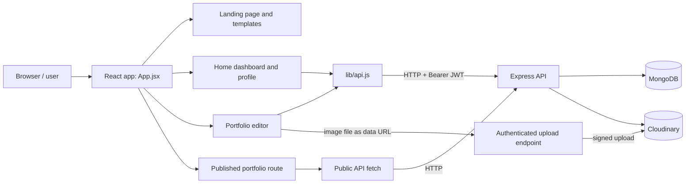
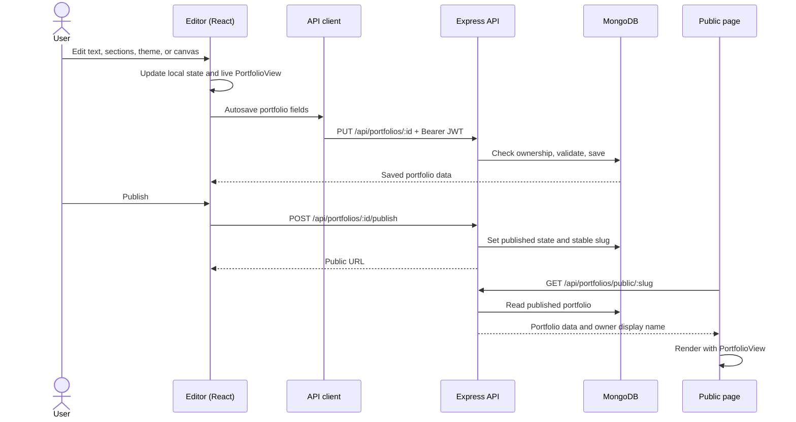

# Pagecraft frontend

The frontend is the React 19 single-page application served by Vite. It provides the public marketing site, account entry points, portfolio dashboard, visual editor, print/PDF flow, and public portfolio pages. The backend and database are documented in [`../Backend/README.md`](../Backend/README.md); the short project overview and feature map live in [`../README.md`](../README.md).

## Run the frontend

From this directory:

```powershell
npm install
npm run dev
```

Vite normally serves `http://localhost:5173`. If that port is occupied, Vite can select another port (for example, `5174`). Start the API separately from `../Backend` using its README instructions.

Set `VITE_API_URL` in a local `Frontend/.env` only when the API is not at `http://localhost:5000`:

```dotenv
VITE_API_URL=http://localhost:5000
```

Vite exposes only variables prefixed with `VITE_` to browser code. Never put database, JWT, email, or Cloudinary secrets in this file. The backend's CORS configuration permits localhost development origins on any port; production origins must be configured on the backend.

Useful scripts:

| Command | Purpose |
| --- | --- |
| `npm run dev` | Start the Vite development server. |
| `npm run build` | Create the production bundle in `dist/`. |
| `npm run preview` | Serve the built frontend locally for a deployment-style preview. |
| `npm run lint` | Run Oxlint on the frontend source. |

## How the frontend fits into the system



The browser owns the editing interaction and preview. The server verifies sessions, validates and stores portfolio data, handles publication and visits, and signs image uploads. MongoDB stores users and portfolios; Cloudinary stores newly uploaded image files. A published page is still rendered by the same React `PortfolioView`, using data fetched from a public API endpoint.

## Routes and user journey

`src/main.jsx` mounts the application in `src/App.jsx`. The router exposes:

| URL | Page | Access |
| --- | --- | --- |
| `/` | Marketing page, template chooser, and sign-in/sign-up modal | Public |
| `/home` | Portfolio list and account profile | Requires a token in browser `localStorage` |
| `/editor/:id` | Editor for a saved portfolio or a temporary draft | Requires a token in browser `localStorage` |
| `/p/:slug` | Published portfolio | Public |
| `/reset-password` | Password reset form | Public |

The landing page can remember a selected template in `sessionStorage` while the user signs up. The dashboard fetches the user's portfolios and profile, then opens, duplicates, deletes, or creates a portfolio. A new editor draft may first live in `sessionStorage`; the editor creates it on the API when it is saved, then replaces the temporary URL with the database portfolio ID.

## Editor and rendering model

The main editing behavior is in `src/pages/Editor.jsx`; `src/components/PortfolioView.jsx` renders both the editor preview and the public page. `src/data/templates.js` defines template metadata, default section content, themes, and the section library. Resume layouts are handled by `ResumePortfolio.jsx`.

For the standard, editable templates, a portfolio is data: a template ID, ordered section records, optional canvas elements, and theme settings. The editor changes that data in React state and feeds it to `PortfolioView`, so the preview updates immediately. The section list supports drag and drop plus keyboard and button reordering. Text and layout controls write to the same portfolio state. Undo/redo is maintained in the editor. Changes are autosaved through the API; the editor indicates save status and keeps the last saved ID.

The server sanitizes the data as it is saved, including section types, supported fonts/layouts, text lengths, canvas-element counts, image formats, and crop bounds. See the backend portfolio schema and validation guide for the persistence limits.

### Template rendering paths

- Built-in Pagecraft and resume templates render from portfolio data through `PortfolioView` (and `ResumePortfolio` for resumes).
- Folio Freelancer and Grunge use the Pagecraft section schema and their bundled visual assets.
- The supplied iPortfolio Bootstrap template is served as a static template under `public/templates/iPortfolio-1.0.0`. The editor/public renderer loads it in an iframe and provides editable text and image overrides while preserving the original layout. Its original contact form posts to its PHP endpoint and needs PHP-capable hosting to send messages.

Do not move a template asset out of `public/` if it needs to be loaded by its original URL at runtime. Imported source templates and their license/attribution files are kept with their assets.

## Save, publish, and view flow



Use **Preview site** to see the portfolio without editor controls. **Export PDF** invokes the browser print dialog; choose **Save as PDF** there. Publishing creates a shareable `/p/:slug` URL. Public view counting is sent separately after the page remains visible for a short interval; owner views are not counted, and repeat views from the same browser are rate-limited by the backend.

## Authentication and API calls

`src/lib/api.js` is the shared authenticated fetch helper. It reads the JWT from `localStorage`, adds `Authorization: Bearer <token>`, sets JSON content type for JSON bodies, parses JSON responses, and turns failed responses into errors. `clearSession()` removes the token and cached user. Public portfolio loading uses `fetch` directly because it does not require an account. The browser stores a non-secret session token and basic user profile; authorization still happens on every protected server request.

Google sign-in is initiated from the auth modal and verified by the API. Password reset links are delivered by the backend when email is configured.

## Source map

| Path | Responsibility |
| --- | --- |
| `src/App.jsx` | Route table, auth gate, landing page composition. |
| `src/pages/Home.jsx` | Portfolio dashboard, profile settings, CRUD actions. |
| `src/pages/Editor.jsx` | Editor state, autosave, section/canvas controls, publish, print. |
| `src/pages/PublicPortfolio.jsx` | Public data load, visit event, public page shell. |
| `src/components/PortfolioView.jsx` | Shared template/section renderer and editable preview behavior. |
| `src/components/ResumePortfolio.jsx` | Resume-specific data-driven layouts. |
| `src/data/templates.js` | Template definitions, sample content, section types. |
| `src/lib/api.js` | API base URL, authenticated fetch helper, session cleanup. |
| `public/templates/` | Static assets for the supplied legacy iPortfolio site. |

## Images and PDF

The editor sends an image to `POST /api/uploads/image`; the frontend reads the selected file and uploads it through the authenticated API. The backend sends it to Cloudinary and returns a secure URL that is saved in the portfolio. Image fields also support bundled template assets and legacy image data URLs for existing content. The editor supports PNG, JPEG, WebP, and GIF uploads, with a 5 MB per-image limit and additional aggregate limits for galleries/template images.

PDF export does not create a server-side PDF. The app applies print styles and opens the browser's native print dialog. Results depend on the browser's print settings (for example, background graphics and margins).

## Troubleshooting

- **API requests fail:** confirm the backend is running on port `5000`, or set `VITE_API_URL`; inspect the browser network console for the failing API response.
- **CORS error:** in production, set the backend `CLIENT_URL` to the exact frontend origin. During development, use a localhost/127.0.0.1 origin.
- **Login works but a protected route redirects:** the token is absent or expired; sign in again.
- **Uploads are unavailable:** configure Cloudinary credentials on the backend. Never add them to frontend environment variables.
- **Google sign-in fails locally:** add the exact Vite origin, including a fallback port such as `http://localhost:5174`, to the Google OAuth client's authorized JavaScript origins.
- **Legacy iPortfolio form does not send:** that original form targets PHP and requires PHP-capable hosting; the JavaScript API does not process it.
